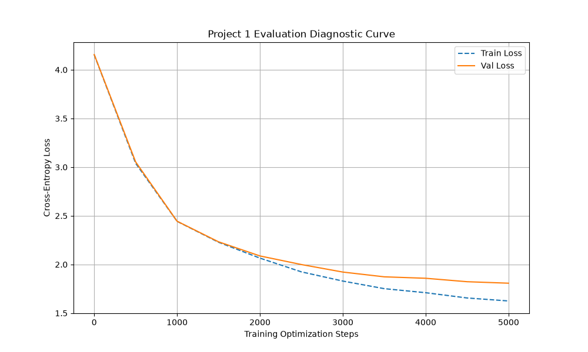

<h1 align="center">Character-Level Transformer From Scratch</h1>

**Trace a small GPT-style model from character IDs through causal attention, training, and generated text.**

Python + PyTorch. CPU or Apple MPS. Tiny Shakespeare downloads separately; running the main script trains a model.

By Om Patnaik · repository created July 2026.

## Install

| Platform / path | Start here |
| --- | --- |
| Python | `pip install -r requirements.txt` in a virtual environment |

Download Tiny Shakespeare to `input.txt`, then inspect or run `transformer.py`. For a no-training walkthrough, start with `WRITEUP.md` and the saved training curve.

```bash
python -m compileall -q transformer.py  # inspect syntax without starting training
```

## Why

You want to understand the tensor shapes and training steps hidden inside a language-model library. This repo implements a small decoder-only transformer with sinusoidal positions, causal multi-head attention, residual blocks, and a tied output head. Generated text is an educational result, not a production language model.

## Results



The configured run uses 5,000 training steps and evaluates every 500 steps. The plot is saved run evidence; no unsupported final-loss number is claimed.

Rebuild with `python transformer.py` after preparing `input.txt`; this starts training. [Implementation and plotting code](transformer.py) · [Learning writeup](WRITEUP.md).

## Follow the tensor shapes

Read character encoding, batching, embeddings, positional encoding, attention, and loss in order. `CORRECTIONS.md` explains fixes to the learning material.

## Generate after fitting

The script prints loss and perplexity, samples text, and saves `training_curves.png`. It is configured for a small corpus and fixed context length; a loss curve alone does not establish useful language ability.

## Notes from building it

I kept the implementation small enough to inspect each tensor operation. Separating evaluation frequency from the number of evaluation batches corrected an important training-loop detail. I would add resumable full-state checkpoints before relying on a longer run.

## Commands

```bash
curl -L -o input.txt https://raw.githubusercontent.com/karpathy/char-rnn/master/data/tinyshakespeare/input.txt  # fetch the corpus
python transformer.py                         # train, sample, and plot
python -m compileall -q transformer.py          # check syntax without training
```

## Verify it yourself

```bash
python -m compileall -q transformer.py
```

Syntax checking does not validate attention numerics or rerun the model. The repository has no automated tensor-shape or causal-mask suite; use the writeup and implementation to inspect those assumptions.

## Credits, license and pointers

Built with PyTorch, Matplotlib, and Tiny Shakespeare from Andrej Karpathy’s `char-rnn` dataset. Sinusoidal positions follow the original Transformer formulation. TARQ learning project; no source license file is present.

[Full setup, original notes, and project history](README-DETAILS.md).
